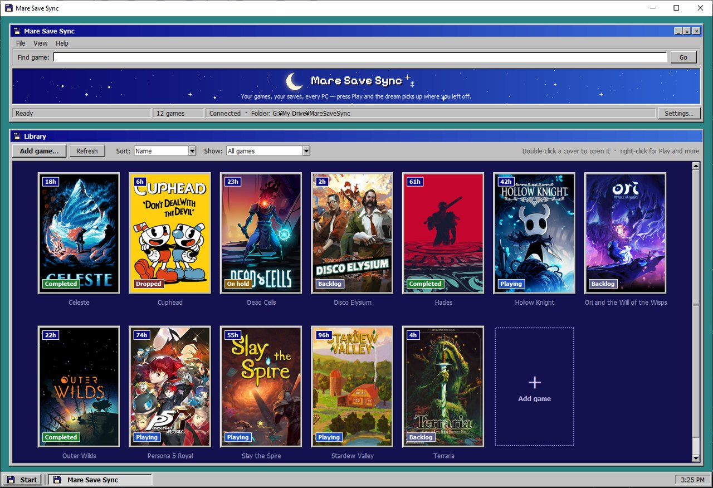
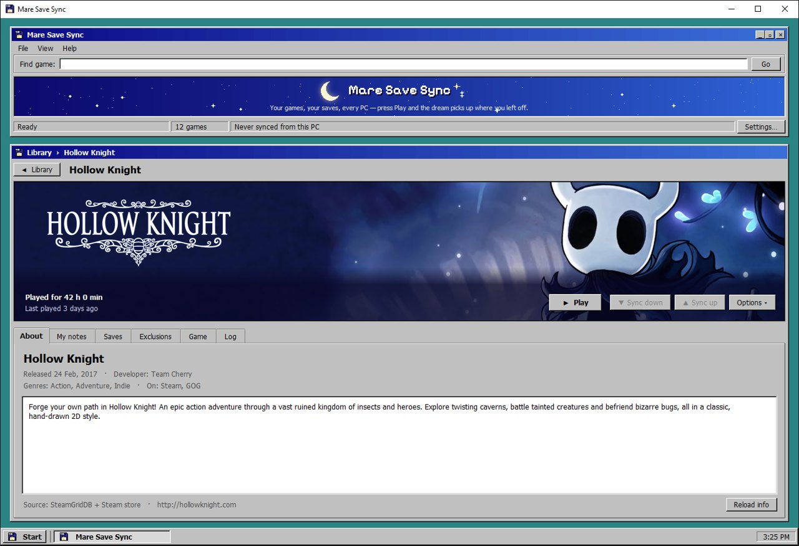
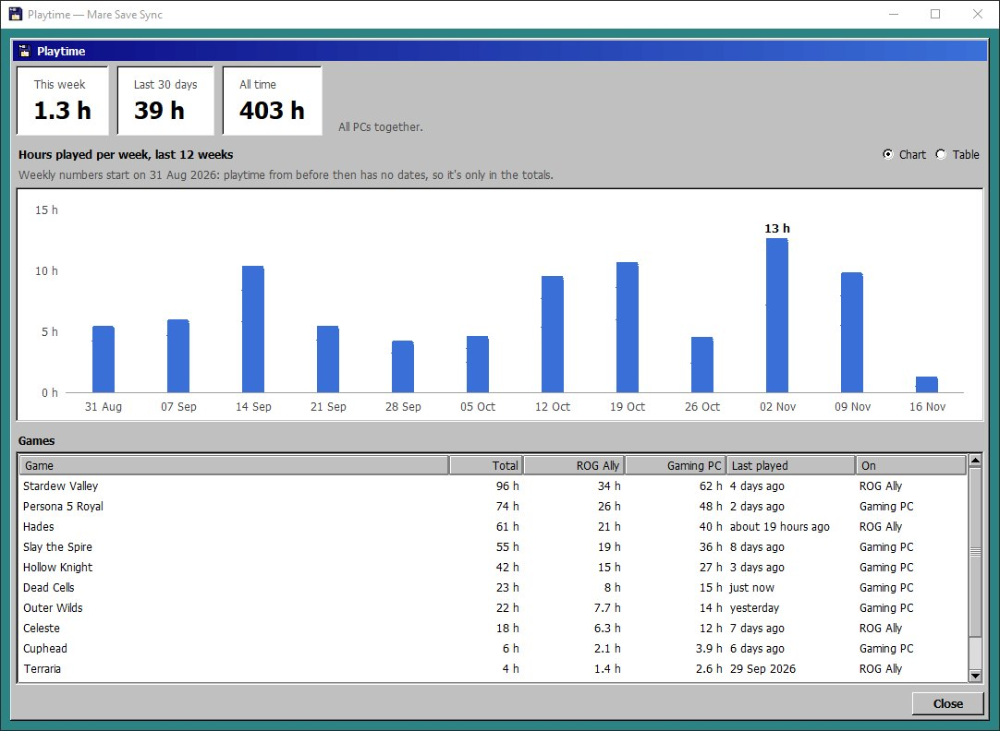
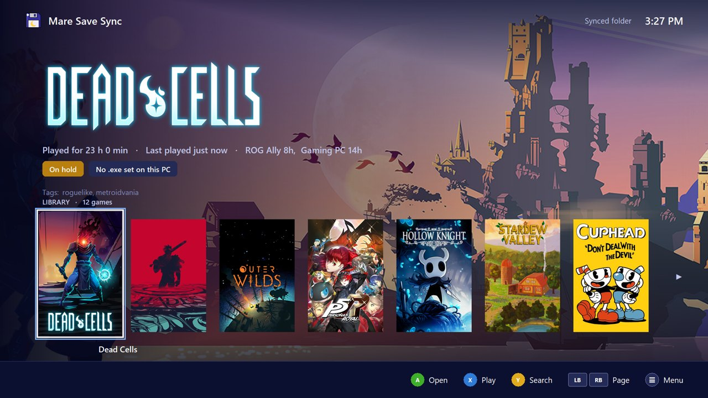

# 🌙 Mare Save Sync

**Your games, your saves, every PC. Press Play and pick up right where you left off.**

Ever beaten a boss on your desktop, then grabbed your laptop or handheld and found you're back before the fight?
Mare Save Sync fixes that. It's a good-looking game library that moves your save files between your PCs
through your own Google Drive, so the progress you made on one PC is waiting on the next.

  

  <a href="https://github.com/hungofhydra/MareSaveSync/releases/latest"><b>⬇ Download for Windows (free)</b></a>

---

## Why you'll like it

### ▶ Press Play. That's all.
Start your games from Mare Save Sync and it does the rest: it brings down your newest saves before the game
starts and sends them back up when you quit. No copying folders, no USB sticks, no "which one is newer?"

### 🔍 It finds your saves for you
Add a game and Mare Save Sync knows where it keeps its saves, for more than 20,000 PC games. Your other PCs find
them too, so you set a game up once.

### 🎨 A library that looks great
Covers, banners, logos and game descriptions are filled in for you. Sort by name, last played or most played,
and mark each game *Playing*, *Backlog*, *Completed* and so on, with your own tags and notes.

  

### ⏱ See how much you really play
Playtime is counted on every PC and added together: this week, the last 30 days, all time, week by week, and
per PC.

  

### 🎮 Made for handhelds too
A full-screen mode built for a controller, for the ROG Ally, Legion Go and other Windows handhelds. Browse,
play and sync without ever touching a mouse.

  

### 🛟 Your saves are safe
- Before your saves are replaced, the old ones are backed up first.
- If you played on two PCs without syncing, it notices and asks which to keep. It never guesses.
- Everything stays in **your** Google Drive. The app can only see the files it made, not the rest of your Drive.

### 👾 Old favourites, too
Works with emulators like RetroArch, Dolphin, PCSX2 and many more, so your retro saves travel with you as well.

---

## Get started in 3 steps

1. **[Download the latest version](https://github.com/hungofhydra/MareSaveSync/releases/latest)**, unzip it
   anywhere and open `MareSaveSync.exe`. Nothing to install.
   *(If Windows says "Windows protected your PC", click **More info → Run anyway**.)*
2. **Sign in with Google**, or pick a folder that's already synced, like your Google Drive folder.
3. **Add your games** and press **Play**.

Do the same on your other PCs, and your saves follow you. 🎉

The app updates itself: when there's a new version, an **Update** button appears. Nothing changes until you
click it.

---

## Questions

**Is it free?** Yes.

**Do I need Google Drive?** You need somewhere to keep your saves between PCs. Google Drive works out of the box,
and any folder that syncs across your PCs works too.

**Does it work with Steam, Epic or GOG games?** Yes. It works with any Windows game, wherever you got it.
Games that already sync through Steam Cloud keep doing that on their own.

**What doesn't it sync?** Achievements, and the few games that keep saves in the Windows registry or the Xbox app.

**Can I put it on a USB stick?** Yes. It keeps everything in its own folder, so you can carry it around.

---

## Want all the details?

The **[full guide](docs/GUIDE.md)** covers every feature: desktop shortcuts, commands before and after a game,
excluding files, emulator setup, fullscreen mode's controls, where files are kept, building from source and more.

Found a problem? In the app, open **Help → Log…**, click **Copy for bug report**, and paste it into a
[new issue](https://github.com/hungofhydra/MareSaveSync/issues).
